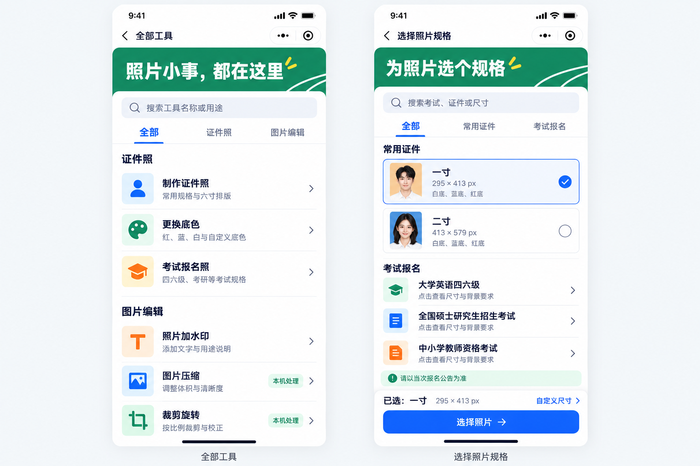
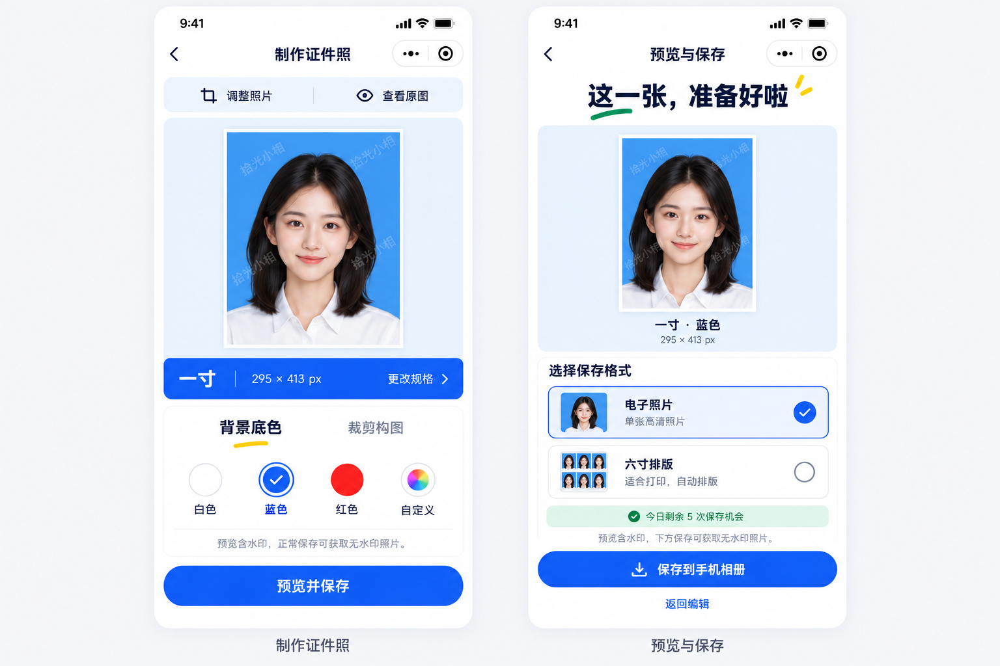
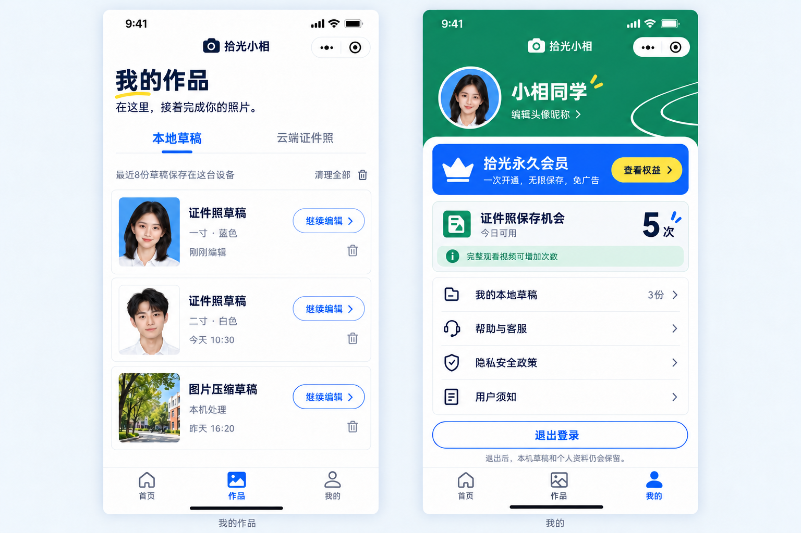
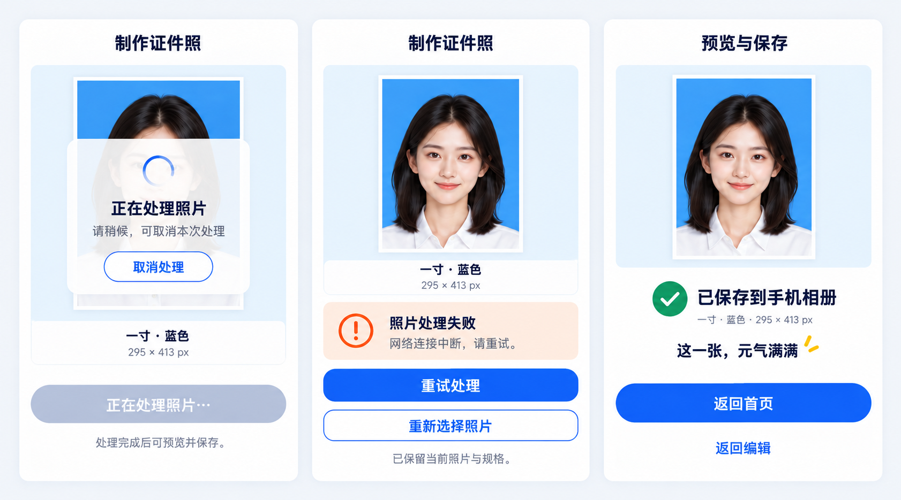

# 拾光小相 · 青春校园 UI 重设计 V3

2026-11-02 设计稿；2026-11-03 用户要求按本稿开始编码，已进入原生实现。实现与验证见 [实施验收记录](implementation-report-20261103.md)；最新修复、140项测试和验证边界见 [UI/UX走查记录](audit-20261103/README.md)。
本轮已完成7个核心页面的高保真静态概念，以及3个关键交互状态的细节设计。
11月2日阶段只新增设计图片与文档；11月3日已在原生小程序中实现核心页面，保留业务接口与用户原有工作区改动。

## 直接看设计

| 图稿 | 页面/状态 | 本轮重新设计重点 |
| --- | --- | --- |
| [01 首页](01-home.png) | 首页 | 缩小口号、强调照片与开始制作；蓝黄主入口、绿色考试入口、紧凑草稿恢复 |
| [02 工具与规格](02-tools-specs.png) | 全部工具、选择照片规格 | 分组列表、搜索、选择勾选、已选摘要、清晰的下一步 |
| [03 编辑与保存](03-editor-save.png) | 制作证件照、预览与保存 | 大预览、底色与格式选择、尺寸、水印和额度就近说明 |
| [04 作品与我的](04-works-profile.png) | 我的作品、我的 | 草稿与云端分开、继续编辑、账号与权益、帮助与隐私 |
| [05 交互状态](05-interaction-states.png) | 处理中、失败恢复、保存成功 | 可取消、保留作品并重试、明确保存位置与后续操作 |

## 设计图

### 首页

### 全部工具与规格选择

### 编辑与保存

### 作品与我的

### 三个关键状态

## 理论如何体现在图里

依据为Don Norman的情感化设计三层次。原文：https://jnd.org/emotional-design-people-and-things/
下面为针对本项目的设计推导，不是理论对颜色、尺寸或动效的规定。

| 层次 | 在新稿中的可见结果 |
| --- | --- |
| 本能层：第一印象 | 首页亮蓝、草绿、柠檬黄；成年学生样片与相片白边；运动场线条只作少量品牌装饰 |
| 行为层：使用体验 | 选中规格/底色/格式都有明确勾选；每个工作页面一个主要动作；处理中不可重复提交并可取消；失败保留照片与规格 |
| 反思层：完成后的感受 | 保存成功以自己的照片为主，明确“已保存到手机相册”；用轻微元气文案增强完成感，作品页可找回草稿 |

与此前第二版相比，首页口号缩小、跑道装饰减少，主入口更集中；其他页面围绕操作任务重新组织，并非把首页色彩直接复制过去。

## 交互说明

首页：开始制作 → 规格选择。次要工具和考试入口各有独立层级；草稿行的继续编辑明确可见。

规格：搜索与分类帮助找到用途；当前预设用边框和勾选表示，底部摘要再次确认；选择照片是唯一填色主按钮。图稿把常用预设选择与规格浏览放在同一设计表面，属于设计提案，若实施需结合现有spec-picker、specs与spec-detail路线确认入口映射。

编辑：预览/原图对比与操作分开；更改规格在尺寸旁；底色用名称、色块和勾选共同表达；底部只保留预览并保存。

保存：电子照片与六寸排版使用同一单选行组件；水印、格式与额度说明在操作前可见；预览状态不提前显示成功。

处理中：显示真实阶段，不编造百分比；保留照片、规格与取消处理入口，主保存动作不可用。
失败：就近说明网络错误，保留照片和规格；重试处理为主，重新选图为次。
成功：确认保存到手机相册，呈现尺寸信息；返回首页为主，返回编辑为次。

作品：本地草稿与云端成品切换；本地草稿逐条展示缩略图、规格、时间和继续编辑。删除图标保持次要。
我的：资料、会员、使用状态、帮助隐私与退出分组。绿色额度说明为信息提示，没有播放广告的伪按钮。

## 核对与修订记录

- 主次层级：对照首页、规格、编辑和保存图，确认每个操作页面均有明确主动作；次要操作使用文本或描边。
- 选择状态：规格、底色和保存格式均有勾选或单选标记，避免仅凭颜色。
- 内容一致：已将作品页第二张男性草稿的底色修订为白色，与“二寸·白色”对应。
- 交互语义：已移除我的页面额度说明中的播放图标和箭头，避免误导成新增广告入口。
- 装饰边界：已移除作品列表底部与内容相碰的绿色曲线；编辑和保存采用更安静的预览区域。
- 失败恢复：单独绘制保留照片、规格、重试和重新选择的状态。
- 成功反馈：仅在保存成功细节稿显示“已保存到手机相册”；正常保存页没有提前出现成功提示。
- 文案：图稿保留现有工具名称与关键动作；“青春，正好上镜”“照片小事，轻松搞定”等为本次设计新文案。示例昵称、作品、时间、额度均为演示数据。

## 交付边界

这5张图为内置image_gen生成并检查的静态设计稿。原始生成提示词见[prompts.md](prompts.md)。
7个页面和3个关键状态的静态设计保留在本目录；11月3日已实现对应原生界面并做模拟器交互检查。真机与真实服务验证边界见实施验收记录。
生成图中局部阴影、色彩过渡、图标和个别人像存在生成差异；它们用于设计审阅。若进入实施，需将字号、圆角、图标、纯色值与媒体素材统一为明确组件规范。
当前并非整个产品所有二级页与边界状态的逐页成品；会员购买、客服详情、工具专用编辑等后续延展沿用这套系统，本轮交付范围为7个核心页面和3个关键状态。
