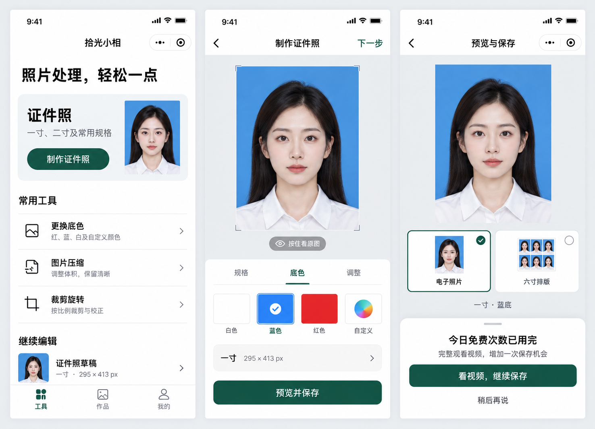

# 拾光小相 · Skyline 界面重构方案

日期：2026-10-22。状态：已按此方案完成本地开发；模拟器与接口验证结果、真机验收边界见 [开发验收说明](开发验收说明.md)。

## 目标与约束

以证件照为主要入口，扩展成轻量照片工具箱。重新设计页面组织、编辑流程、登录时机与导出交互；保留当前 Java / Python 服务的接口路径、请求字段、图像处理职责和业务配额规则。

所有页面继续使用 Skyline 和 glass-easel。实现使用原生 WXML / WXSS / JS，按 Skyline 能力选择组件；不会通过内嵌网页替代小程序。概念图只用于确认视觉方向，不能代替开发者工具与真机验收。

## 页面结构

底部导航采用「工具 / 作品 / 我的」三个入口。

| 页面 | 用户任务 | 主要内容 |
| --- | --- | --- |
| 工具首页 | 快速开始一项照片任务 | 证件照主入口、更换证件照底色、压缩、裁剪旋转、本地草稿恢复 |
| 规格选择浮层 | 先确定照片用途 | 常用规格与自定义宽高；选择后拍摄或从相册选图 |
| 制作工作台 | 专注编辑一张照片 | 大图预览；规格、底色、调整三个面板；按住对比原图；一个导出入口 |
| 预览与保存 | 确定输出方式 | 电子照片或六寸排版；尺寸说明；保存按钮；必要时登录和观看广告 |
| 作品 | 找到成品或继续编辑 | 分开展示本地草稿和云端证件照历史；支持预览和已有的单条删除 |
| 我的 | 管理身份和使用状态 | 微信登录、当天配额、客服、隐私说明、清理本地草稿和缓存 |

首页的证件照占主要视觉位置，其余工具采用清晰列表，不堆叠营销卡片。首页不要求登录，不自动播放广告。

## 核心交互

1. 用户选择工具；证件照可先选规格，再选照片。默认规格应可直接继续，不强制搜索。
2. 进入工作台后保留原图、本次处理结果、规格和颜色，持久化本地草稿元数据与可恢复文件。
3. 工作台预览占主要空间。规格切换需确认后才调用处理接口；底色选择保留防抖与最新响应保护，处理中显示明确阶段，不显示虚构的完成百分比。
4. 只有一个主要操作「预览并保存」。编辑页顶部只保留返回与微信系统胶囊，删除概念图中重复的「下一步」。
5. 导出页选择电子照片或六寸排版。排版选项先用本地示意缩略图展示，真正保存时才请求后端排版，避免预览就消耗已有后端配额。
6. 首次保存时在当前流程中调用既有微信登录接口；不跳走到个人页，登录成功后继续原作品。
7. 保持每天 5 次免费保存、广告增加额度、当天观看满 5 次后不限次数的现有规则。只有额度不足、用户主动点击后才展示激励视频。
8. 未完整观看、无广告库存、网络失败时保留作品；允许返回编辑或稍后再试。完整观看并记录奖励成功后，继续原单图或排版操作。
9. 保存成功后明确提示结果已进入手机相册；云端历史保留规则应与实际实现一致。本地工具产物不默认宣称云同步。

## 新功能建议与接口边界

| 功能 | 实现路径 | 当前阶段 |
| --- | --- | --- |
| 常用规格选择与自定义尺寸 | 前端规格配置，复用 `/api/photo/generate-idphoto` 的 `height` / `width` | 已实现 |
| 原图对比、本地草稿、登录后继续 | 前端状态与文件管理，登录复用 `/api/user/login` | 已实现；真实登录待真机验收 |
| 图片压缩 | 小程序端处理，显示实际体积与清晰度预览；不更改后端接口 | 已实现并通过模拟器处理验证 |
| 裁剪、旋转 | 前端图片处理模块；输出结果可进入原有证件照流程 | 已实现并通过模拟器处理验证 |
| 更换证件照底色 | 复用现有抠图和背景接口 | 保留核心能力 |
| 通用商品抠图 | 需要增加或扩展 Java 对 Python 的接口适配；证件照接口依赖人脸，不等同通用抠图 | 后续讨论 |
| 美白、亮度、渐变、水印、精确 KB 输出 | Python 有相关能力，但当前 Java 未暴露全部参数；不能仅加界面就承诺可用 | 后续讨论 |
| AI 换装、旧照修复、头像生成 | 需要额外服务或算法 | 不纳入当前提案 |

首批本地工具不使用云端额度，也不通过广告奖励接口伪造保存次数；其产物只保存在本地。若后续希望统一云端作品库或商业规则，需要单独确定接口和数据模型。

## 视觉与 Skyline 落地要求

- 视觉方向：白底、墨绿主操作、深灰正文、照片作为主视觉；减少装饰与重复操作。
- 导航按微信胶囊位置、安全区和状态栏高度布局；工作台不显示首页 TabBar。
- 操作目标至少按 44px 设计；底色同时使用颜色名和勾选标记区分状态。
- 弹层优先用已验证兼容的组件；尺寸、颜色和导出选项统一布局与状态反馈。
- 使用真实节点与受支持样式实现，控制图片 Base64 对 `setData` 和内存的影响；草稿应采用本地文件，不把全部图片写入 Storage。
- 页面隐藏时保存草稿，卸载时清理请求回调、计时器和广告监听；不把临时文件路径当作永久草稿。
- 分别验证浅色、深色、长屏、小屏、相册权限拒绝、网络慢和广告加载失败；最终以 Skyline 真机结果验收。

## 概念图

概念图中的人物、草稿和结果为设计演示数据。实际实现保留顶部微信胶囊，移除编辑页重复的「下一步」，只保留底部导出入口；没有本地草稿时显示真实空状态。实际 Skyline 截图保存在同目录 `design/skyline-*.png`。

生成方式：内置 ImageGen。提示词摘要：三屏完整微信小程序概念、中文原生 UI、白底墨绿照片工作室、首页证件照与常用工具、编辑页大预览与分组面板、导出页可选激励视频、Skyline 可实现的布局、不包含新 AI 算法能力。

## 已完成的广告准备工作

已填入用户提供的激励视频 ID `adunit-8643a04d0caed362`。当前前端显式配置优先，避免线上旧广告位覆盖；清空 `rewardedVideoAdUnitIdOverride` 后可恢复后端下发。后端配置支持 `WX_REWARDED_AD_UNIT_ID` 环境变量覆盖。已补齐完整观看判定、首次展示失败后的加载重试、卸载清理、重复点击保护、单图与排版分别重试。

`tests/` 已包含 29 项回归验证，覆盖广告状态、原操作重试、草稿持久化与失败补偿、裁剪几何、接口兼容和 Skyline 配置等。它们不代表广告位实际填充或真机投放验证。尚未部署或提交微信审核。
